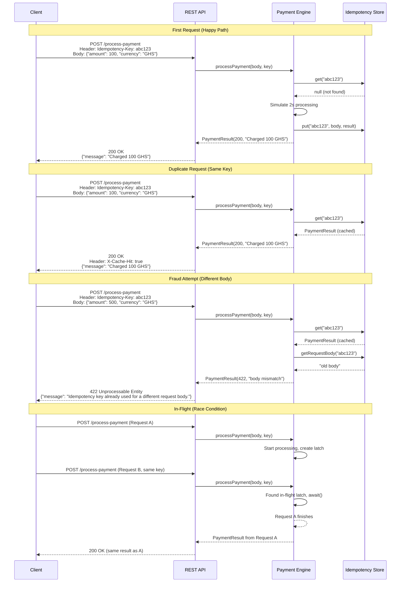

# Idempotency Gateway

A simple payment processing service that guarantees each payment is processed exactly once, even if the client retries the request.

## Architecture



## Setup

### Prerequisites
- JDK 17 or higher
- No database required (in-memory storage)

### Run locally

```bash
# Build
./gradlew build          # Linux/macOS
gradlew.bat build        # Windows

# Run
./gradlew run            # Linux/macOS
gradlew.bat run          # Windows
```

The server starts on `http://localhost:8080`.

### Health Check

```bash
curl http://localhost:8080/health
# Should return: OK
```

## API Documentation

### POST /process-payment

Process a payment request with idempotency protection.

**Headers:**
- `Idempotency-Key` (required): A unique string to identify this payment attempt
- `Content-Type`: application/json

**Request Body:**
```json
{
    "amount": 100,
    "currency": "GHS"
}
```

**Responses:**

| Status | Meaning | Example |
|--------|---------|---------|
| 200 | Payment processed successfully | `{"message": "Charged 100 GHS"}` |
| 400 | Missing header or invalid body | `{"error": "Missing Idempotency-Key header"}` |
| 422 | Key already used with different body | `{"message": "Idempotency key already used for a different request body."}` |

**Examples:**

First request:
```bash
curl -X POST http://localhost:8080/process-payment \
  -H "Content-Type: application/json" \
  -H "Idempotency-Key: unique-key-123" \
  -d '{"amount": 100, "currency": "GHS"}'
```

Response:
```json
{"message": "Charged 100 GHS"}
```

Duplicate request (returns cached response):
```bash
curl -X POST http://localhost:8080/process-payment \
  -H "Content-Type: application/json" \
  -H "Idempotency-Key: unique-key-123" \
  -d '{"amount": 100, "currency": "GHS"}'
```

Response includes `X-Cache-Hit: true` header.

## Design Decisions

**Why in-memory storage?**
For this challenge, a `ConcurrentHashMap` is sufficient. It keeps the implementation simple and avoids database setup complexity. In production, you'd use Redis or a database with proper persistence.

**Why 2-second delay?**
The delay simulates real-world payment processing time (calling a payment provider, waiting for response). This makes the idempotency behavior observable during testing.

**Why Thread.sleep instead of coroutines?**
Keeps the code accessible to Java developers. The `CountDownLatch` approach for handling in-flight requests is a standard Java concurrency pattern.

## Developer's Choice Feature

### Idempotency Key Expiration (TTL)

Idempotency keys automatically expire after **24 hours**. This prevents unbounded storage growth in long-running deployments.

**Why this matters:**
- Without TTL, the store grows indefinitely
- Old keys are unlikely to be retried after 24 hours
- Keeps memory usage predictable

**Implementation:**
Each stored entry includes a `createdAt` timestamp. On every access, the store checks if the entry is older than 24 hours and removes it if so (lazy cleanup).

## Project Structure

```
src/main/kotlin/idempotency/
├── App.kt                    # Server setup and configuration
├── api/
│   └── PaymentRoutes.kt      # HTTP endpoint definitions
├── engine/
│   └── PaymentEngine.kt      # Core idempotency logic
├── model/
│   └── Models.kt             # Data classes
└── store/
    └── IdempotencyStore.kt   # In-memory key-value store
```
