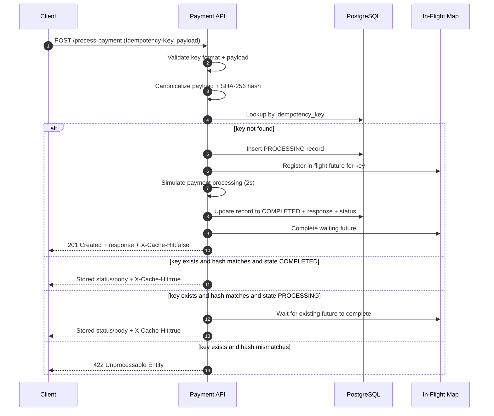

# Idempotency-Gateway (Pay-Once Protocol)

Spring Boot + PostgreSQL implementation of an idempotent payment processing API that guarantees **exactly-once charging semantics** per `Idempotency-Key`.

## Architecture Diagram



## Setup Instructions

### Prerequisites
- Java 17+
- Maven 3.9+
- Docker (for PostgreSQL)

### 1) Start PostgreSQL
```bash
docker compose up -d
```

### 2) Run the API
```bash
mvn spring-boot:run
```

The app starts on `http://localhost:8080`.

### 3) Run tests
```bash
mvn test
```

## API Documentation

### Endpoint
- `POST /process-payment`

### Required Headers
- `Idempotency-Key: <8-128 chars, letters/numbers/_/->`

### Request Body
```json
{
  "amount": 100,
  "currency": "GHS"
}
```

### Response Scenarios

1) **First request (new key)**
- Status: `201 Created`
- Header: `X-Cache-Hit: false`
- Body:
```json
{
  "status": "Charged 100 GHS"
}
```

2) **Duplicate request (same key + same payload)**
- Status: Same as first request (`201`)
- Header: `X-Cache-Hit: true`
- Body: Exactly same as first response
- No extra processing delay

3) **Same key + different payload**
- Status: `422 Unprocessable Entity`
- Body:
```json
{
  "error": "Idempotency key already used for a different request body."
}
```

### Example cURL Commands

First charge:
```bash
curl -i -X POST http://localhost:8080/process-payment \
  -H "Content-Type: application/json" \
  -H "Idempotency-Key: order-12345_A" \
  -d "{\"amount\":100,\"currency\":\"GHS\"}"
```

Duplicate replay:
```bash
curl -i -X POST http://localhost:8080/process-payment \
  -H "Content-Type: application/json" \
  -H "Idempotency-Key: order-12345_A" \
  -d "{\"amount\":100,\"currency\":\"GHS\"}"
```

Conflict payload:
```bash
curl -i -X POST http://localhost:8080/process-payment \
  -H "Content-Type: application/json" \
  -H "Idempotency-Key: order-12345_A" \
  -d "{\"amount\":500,\"currency\":\"GHS\"}"
```

## Design Decisions

- **Database-backed idempotency ledger:** `payment_records` stores idempotency key, request hash, state, status code, and response body.
- **Hash-based payload integrity:** Requests are canonicalized and hashed with SHA-256 to detect body tampering/reuse.
- **In-flight concurrency protection:** A per-key `CompletableFuture` map ensures concurrent duplicates wait for the first request instead of double-processing.
- **HTTP replay transparency:** `X-Cache-Hit` clearly indicates replayed responses.
- **Integration tests for race conditions:** Tests verify first-charge, duplicate replay, conflict rejection, and in-flight waiting behavior.

## Developer's Choice: Idempotency-Key Guardrail

I added **strict `Idempotency-Key` format validation**:
- Must be 8-128 characters.
- Allowed chars: letters, numbers, `_`, `-`.

### Why this helps in real fintech systems
- Prevents accidental low-entropy or malformed keys.
- Reduces abuse vectors (e.g., oversized header attacks/noisy key space).
- Improves operational consistency and observability for payment retries.

Invalid keys return:
- `400 Bad Request`
- Error message explaining the key format.
